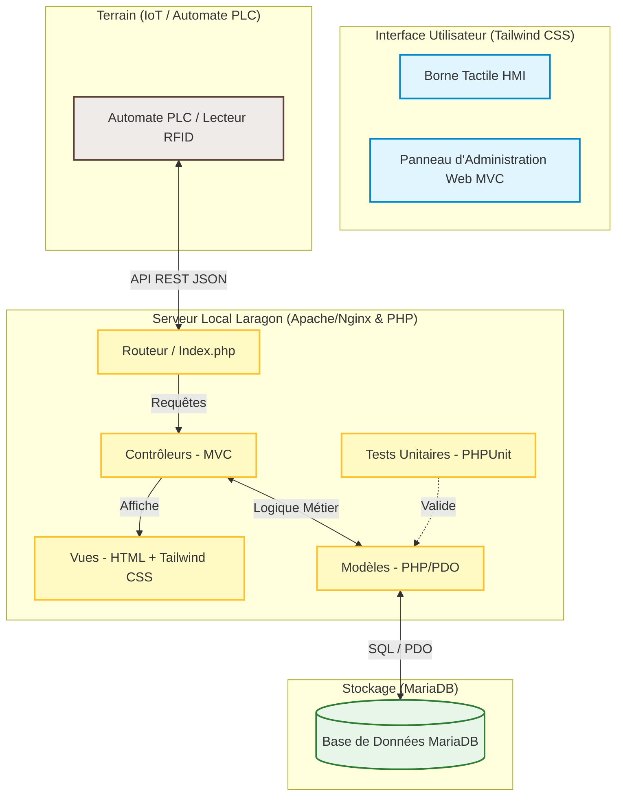
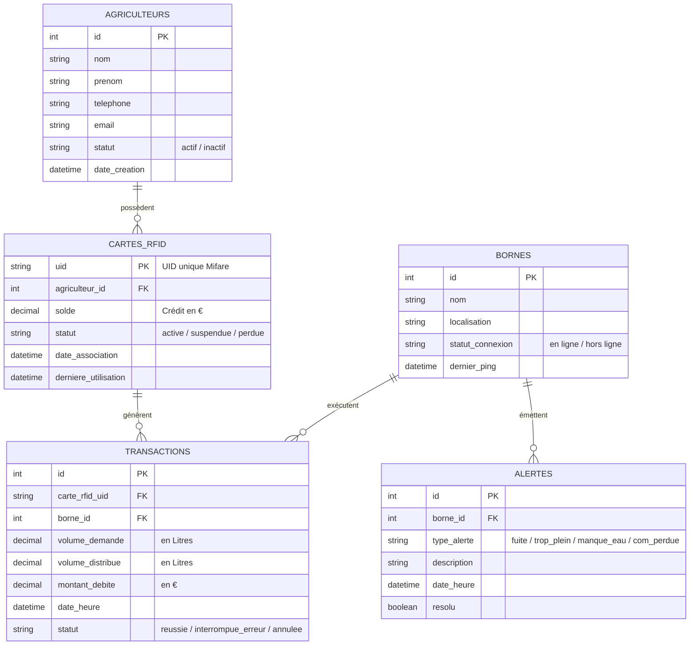

# Conception Générale du Projet : Distribution d'Eau Automatisée par Carte RFID Prépayée

Ce document présente la conception générale, l'architecture technique et les choix technologiques du système de distribution d'eau automatisée par carte RFID prépayée. 

Le projet est développé en **PHP** avec une architecture **MVC**, utilise **MariaDB** sous l'environnement **Laragon**, et intègre **Tailwind CSS** pour l'interface utilisateur ainsi que des **tests unitaires (PHPUnit)** pour garantir la robustesse du code.

---

## 1. Architecture Globale et Technologies

Le système repose sur une architecture 3-tiers adaptée au développement sous **Laragon** :



### 1.1. Choix Technologiques & Environnement

* **Environnement de Développement (Laragon) :**
  - Laragon fournit une suite complète sous Windows : serveur web **Apache/Nginx**, **PHP** et serveur de base de données **MariaDB**.
  - Utilisation de **Composer** pour gérer les dépendances (PHPUnit, Tailwind, routeurs).
* **Architecture Backend (PHP MVC) :**
  - **Model (Modèle) :** Gère la logique d'accès aux données MariaDB via des requêtes SQL préparées (PDO) pour éviter les injections SQL.
  - **View (Vue) :** Templates HTML stylisés avec le framework utility-first **Tailwind CSS**.
  - **Controller (Contrôleur) :** Traite les requêtes HTTP, interagit avec le modèle et charge la vue correspondante ou renvoie du JSON pour la borne interactive.
* **Styling & UI (Tailwind CSS) :**
  - Utilisé pour l'interface de la borne interactive terrain ainsi que le dashboard d'administration web.
  - Assure un design moderne, épuré, fluide (responsive) et rapide à charger.
* **Tests Unitaires (PHPUnit) :**
  - Validation automatique de la logique métier (ex: vérification des règles de calcul du débit de solde, validation d'UID RFID, contrôles de sécurité contre le dépassement de crédit).

---

## 2. Structure et Organisation du Projet (MVC)

La structure des dossiers dans le répertoire de travail Laragon (`C:\laragon\www\water`) s'organise selon le schéma MVC classique :

```text
water/
├── app/
│   ├── Controllers/       # Contrôleurs (ex: CardController.php, AdminController.php)
│   ├── Models/            # Modèles d'accès à la DB (ex: Farmer.php, Card.php, Transaction.php)
│   ├── Views/             # Templates d'affichage (ex: admin/dashboard.php, kiosk/index.php)
│   │   ├── layout/        # En-têtes, pieds de page, imports de Tailwind CSS
│   │   └── errors/
│   └── Core/              # Noyau de l'application (Routeur, Connexion Database PDO)
├── config/                # Fichiers de configuration (config.php, database.php)
├── public/                # Point d'entrée public du serveur web Laragon
│   ├── index.php          # Routeur principal (Front Controller)
│   ├── css/               # Tailwind CSS compilé (dist/style.css)
│   └── js/                # scripts JavaScript interactifs
├── tests/                 # Dossier des Tests Unitaires
│   ├── CardTest.php       # Tests de la logique des cartes
│   ├── TransactionTest.php# Tests du débit de solde et de calcul du volume
│   └── bootstrap.php
├── vendor/                # Dépendances Composer (PHPUnit, etc.)
├── tailwind.config.js     # Configuration de Tailwind CSS
├── composer.json          # Configuration du projet PHP
└── phpunit.xml            # Fichier de configuration de PHPUnit
```

---

## 3. Modélisation de la Base de Données (MariaDB)

Le schéma relationnel MariaDB structure les comptes des agriculteurs, le statut des cartes physiques RFID Mifare, le suivi des distributions d'eau en litres et la journalisation des alertes techniques.



---

## 4. Spécifications Logicielles & Stratégie de Test

### 4.1. Exemple de Scénario de Logique Métier (Modèle PHP)

Le modèle `Card` gère l'état et le crédit prépayé. Il doit lever des exceptions ou rejeter les transactions en cas d'irrégularité.

```php
// Exemple conceptuel de méthode dans app/Models/Card.php
public function debitBalance(float $volumeLitres, float $pricePerLitre): bool {
    $cost = $volumeLitres * $pricePerLitre;
    if ($this->status !== 'active') {
        throw new Exception("Carte inactive ou bloquée.");
    }
    if ($this->balance < $cost) {
        throw new Exception("Solde insuffisant pour le volume demandé.");
    }
    
    $this->balance -= $cost;
    return $this->save(); // Met à jour le solde dans MariaDB
}
```

### 4.2. Stratégie de Tests Unitaires (PHPUnit)

Les tests unitaires valident la logique algorithmique sans dépendre d'une connexion physique ou réseau. Ils garantissent le bon comportement de l'application :

1. **Test d'authentification d'une carte :**
   - Valider qu'une carte active avec solde positif est acceptée.
   - Valider qu'une carte suspendue ou avec un solde nul/négatif est rejetée.
2. **Test du calcul de débit/déduction du solde :**
   - Vérifier que le solde est précisément débité du coût correspondant au volume d'eau réellement consommé.
   - S'assurer que le solde ne peut jamais devenir négatif sous des conditions d'utilisation normales.
3. **Exemple de Test Unitaire (tests/CardTest.php) :**

```php
use PHPUnit\Framework\TestCase;

class CardTest extends TestCase {
    public function testDebitBalanceSuccess() {
        $card = new Card();
        $card->setStatus('active');
        $card->setBalance(100.00); // 100€
        
        // Déduction de 5000 Litres à 0.01€ le litre (= 50€)
        $result = $card->debitBalance(5000, 0.01);
        
        $this->assertTrue($result);
        $this->assertEquals(50.00, $card->getBalance());
    }

    public function testDebitBalanceInsufficientThrowsException() {
        $card = new Card();
        $card->setStatus('active');
        $card->setBalance(10.00); // 10€
        
        $this->expectException(Exception::class);
        // Tente de débiter 2000 Litres à 0.01€ le litre (= 20€)
        $card->debitBalance(2000, 0.01);
    }
}
```

---

## 5. Répartition des Tâches et Plan d'Action de l'Équipe

### 5.1. Nesrine – Responsable Hardware (Hydraulique et Capteurs)
* **Choix et Dimensionnement de la Robinetterie :** Sélection de l'électrovanne motorisée DN100 et du débitmètre DN100.
* **Câblage & Alimentation :** Réalisation des schémas de raccordement électrique pour le terrain.
* **Capteurs physiques :** Intégration des capteurs de niveau, fuite et trop-plein.

### 5.2. Rania – Responsable Hardware (Intégration & Cabinet Électrique)
* **Conception de l'armoire électrique :** Modélisation de l'armoire de commande (PLC, alimentation, modem 4G/5G).
* **Intégration RFID & HMI :** Fixation et étanchéité IP65 de l'écran tactile et du lecteur RFID.
* **Protocoles locaux :** Configuration de la communication Modbus RTU/TCP ou des E/S directes.

### 5.3. Ghofran – Responsable Software (MVC PHP, Tailwind & Tests)
* **Configuration de l'environnement Laragon :** Initialisation du dépôt, configuration de la base MariaDB et mise en place de PHPUnit avec Composer.
* **Développement du noyau MVC :** Implémentation du routeur, des modèles de données et des contrôleurs d'accès.
* **Développement Web Admin & Tailwind CSS :** Création du tableau de bord d'administration web stylisé avec Tailwind CSS (gestion des agriculteurs, transactions, rechargement).
* **Développement des API JSON :** Exposition des endpoints pour que la borne HMI et le PLC puissent authentifier et valider les consommations.
* **Écriture des Tests Unitaires :** Mise en place et couverture par tests unitaires (PHPUnit) de la logique de distribution d'eau et de déduction financière.
